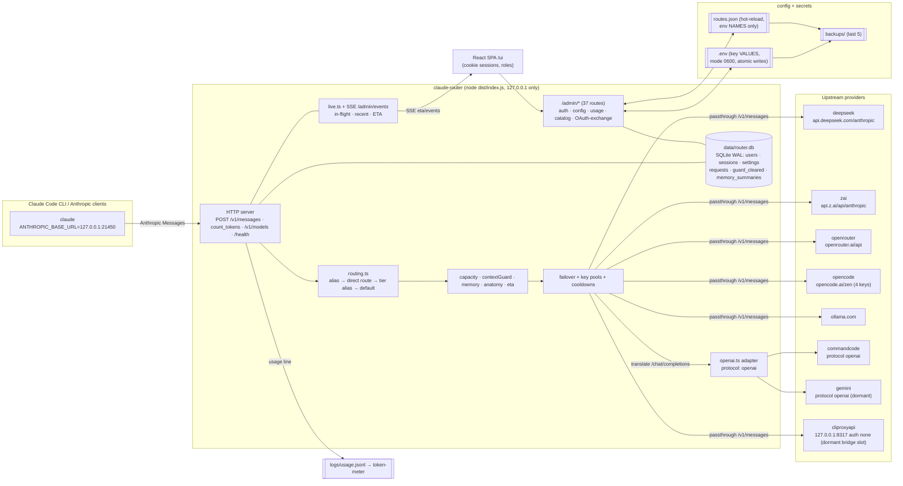

# PROJECT_CURRENT_STATUS_AUDIT.md

**Project:** `claude-router` — local multi-provider AI gateway for Claude Code
**Audit date:** 2026-11-24 · **Branch:** `master` (clean) · **Runtime:** Node v26.12.1, npm 12.2.2, Windows 11 Pro
**Constraints honored:** read-only audit — no source code modified, nothing installed/uninstalled, no configuration changed, no secrets exposed (env var *names* only appear below), no private-API reverse engineering and no browser-cookie extraction performed.

---

## 1. Project Overview

`claude-router` is a **local, single-process Anthropic-compatible proxy** that lets Claude Code (or any Anthropic-Messages-speaking client) route requests to eight configured upstream providers, with key pools, sticky key rotation, cooldown-based failover, cost accounting, and a browser admin UI.

Identity facts (verified from the repo):

- [package.json](package.json): name `claude-router` v1.0.0, `private`, **zero runtime dependencies** (devDeps only: `typescript ^5.9`, `@types/node ^24`), engines `node >=22.13`, build → `dist/index.js`.
- Backend is **Node stdlib only**: `node:http`, `node:sqlite` (`DatabaseSync`, WAL), global `fetch`. No Express, no SDKs.
- Inbound protocol: **Anthropic Messages API only** (`POST /v1/messages`, `POST /v1/messages/count_tokens`, `GET /v1/models`, `GET /health`; `/` redirects to `/ui/live`). There is **no inbound OpenAI `/v1/chat/completions` endpoint**.
- Outbound: Anthropic passthrough **or** OpenAI-compatible translation (`protocol: "openai"`), selected per provider.
- The audit template describes a "Multi-Provider AI Gateway and AI Worker Platform" with desktop app, own CLI, and AI workers. **That framing does not match this codebase.** What exists is the gateway + admin UI + a context-engineering pipeline. Workers, desktop app, and an own CLI product are **not present** (§5, §6, §7); every claim in this report distinguishes *implemented / partial / planned / missing*.

## 2. Complete Structure

```
claude-router/
├─ package.json               root package; workspaces ["src/web"]; build/start/check/smoke scripts
├─ routes.json                LIVE provider/model config, hot-reloaded (env var NAMES only)
├─ .env.example               template: ROUTER_PORT/KEY, ADMIN_*, per-provider key pool names (no values)
├─ claude-settings.example.json  copy-paste Claude Code env (ANTHROPIC_BASE_URL etc.)
├─ CLAUDE.md                  working rules loaded per request (accuracy, token discipline)
├─ TOKEN-RULES.md             on-demand token/cost measurement reference
├─ Notes.md                   developer notes (Z.AI autocompact issue, ETA spec, "One UI only" decision)
├─ README.md                  setup/API docs — partly OUTDATED on the UI section (see §10)
├─ GUIDE-BN.md                Bengali user guide
├─ app.js                     legacy Next.js server stub — DEAD CODE (requires `next`, not a dependency)
├─ prompt/task-list.md        task 16 (CommandCode openai protocol) — already applied
├─ scripts/                   smoke suites (proxy/admin/guard/routing/capacity/memory/providers/discovery/optimise),
│                             token-meter.mjs (reads logs/usage.jsonl), token-benchmark.mjs, statusline, setup-claude.sh
├─ src/
│  ├─ index.ts    (662 loc)   server + hot proxy path, SSE relay, live tracking hooks, startup seeding
│  ├─ config.ts   (592 loc)   .env loader, config types/validators, atomic writes, backups, commitConfig/commitEnv
│  ├─ routing.ts  ( 84 loc)   model resolution, key rotation, header/body shaping
│  ├─ openai.ts   (208 loc)   generic OpenAI⇄Anthropic adapter (request, response, SSE streaming)
│  ├─ admin.ts    (1370 loc)  37 /admin/* routes (regex route table), OAuth exchange, friendly errors
│  ├─ auth.ts     (362 loc)   scrypt users, sessions, roles, throttle, first-run setup, env seeding
│  ├─ db.ts       (178 loc)   node:sqlite (WAL), migrations, SETTING_DEFAULTS
│  ├─ catalog.ts  (361 loc)   26 curated provider cards (incl. CLIProxyAPI bridge + LiteLLM escape hatch)
│  ├─ discovery.ts ( 61 loc)  live model listing (GET {baseURL}/models|/v1/models; 5-min cache; 3 shapes)
│  ├─ live.ts                 in-flight/recent ring/cooldowns/counters/SSE hub
│  ├─ eta.ts                  blended token-speed ETA (rings of last 50 per provider/model)
│  ├─ capacity.ts             daily request/token caps, context-window fit (fitToWindow, 10% headroom)
│  ├─ contextGuard.ts         "observation masking": stubs old tool outputs; per-session cleared ids in SQLite
│  ├─ memory.ts               rolling conversation summaries via cheap model (memory_summaries table)
│  ├─ anatomy.ts              per-part token breakdown of a request
│  ├─ failure.ts              error classification + secret redaction of failure snippets
│  ├─ history.ts / pricing.ts usage log; DeepSeek off-peak pricing windows
│  └─ web/                    React SPA (see below)
├─ data/router.db             SQLite (users, sessions, settings, requests, guard_cleared, memory_summaries)
├─ logs/usage.jsonl           one line per real /v1/messages request (read by token-meter)
├─ backups/                   last 5 timestamped backups of routes.json and .env
└─ dist/                      build output (dist/index.js, dist/ui single-file SPA, dist/ui/icons)
```

React SPA ([src/web/](src/web/src)): React 19 + Ant Design 5 + @lobehub/ui + @lobehub/icons + apexcharts + framer-motion + react-router 7; Vite 8 + `vite-plugin-singlefile` → one self-contained HTML in `dist/ui`. Routes ([App.tsx](src/web/src/App.tsx)): `/live`, `/history`, `/providers`, `/catalog`, `/instructions`, `/models`, `/usage`, `/users`, `/settings/:tab`. Auth-gated; [api.ts](src/web/src/api.ts) uses the session cookie, SSE auto-reconnect (backoff cap 15 s).

Project tooling: `.claude/` Claude-Code memory system with `r-*` commands (README §"Claude AI Development System"). **No CI**: `.github/` does not exist; commit bf9585f says "add husky hooks" but no `.husky/` directory, no `husky` dependency, and no `prepare` script exist in the working tree → hooks are not wired up (§10).

## 3. AI Provider Integration

### 3.1 Architecture

Providers are **configuration, not code** ([routes.json](routes.json) → [src/config.ts](src/config.ts) types). Each provider declares: `baseURL`, `auth` (`none|bearer|x-api-key|both`), `keys` (env var names → values in `.env`), optional `protocol: "openai"`, `dropBodyFields`, `dropBeta`, `disabled`, daily `dailyRequests`/`dailyTokens` caps, per-model `contextWindow`, `capabilities: {tools, vision}`.

Two outbound paths ([src/index.ts](src/index.ts) `proxyMessages`):

```ts
up = await fetch(isOpenAI ? `${p.baseURL}/chat/completions` : `${p.baseURL}/v1/messages`, {
  headers: isOpenAI ? openaiHeaders(p, keyName) : buildHeaders(req, p, keyName),
  body:    isOpenAI ? toOpenAIRequest(fit.body, m, p) : buildBody(fit.body, m, p), signal: ac.signal });
const answer = isOpenAI ? await adaptOpenAI(up, body.stream === true, m.model, estimateTokens(fit.body)) : up;
```

- **Anthropic-style** (default): near-passthrough; [routing.ts](src/routing.ts) `buildHeaders` (anthropic-version passthrough, `dropBeta`) and `buildBody` (`dropBodyFields`, `max_tokens` clamp-down). Streaming is an SSE relay with backpressure handling.
- **OpenAI-style** (`protocol: "openai"`): [src/openai.ts](src/openai.ts) — the **generic OpenAI-compatible adapter is implemented**: converts Anthropic roles/system/tool_use/tool_result/images → OpenAI `messages` + `tools` (function calling) + `tool_choice`; converts responses and SSE back to Anthropic events (`message_start`, `text_delta`, `input_json_delta`, `message_delta` with usage); sets `stream_options: {include_usage}`.

**Dynamic model discovery** ([src/discovery.ts](src/discovery.ts)): `GET {baseURL}/models` (OpenAI-style) or `/v1/models` (Anthropic-style), 10 s timeout, 5-min cache, failures never cached; normalizes `{data:[{id}]}`, `{models:[{id|name}]}`, bare arrays, and plain string arrays. Works for `auth:"none"` providers.

**Capability gate:** a model with explicit `tools:false`/`vision:false` is refused up front with `400` before any upstream spend. Key pools: all keys of the route's provider are available; [routing.ts](src/routing.ts) `keyOrder` rotates the pool by `sha1(seed)` start index (seed = `metadata.user_id` or a system hash) → **sticky keys** keep the provider prompt cache warm.

### 3.2 Configured providers (live `routes.json`)

| # | Provider | baseURL | Protocol | Auth | Keys (env names) | Models (alias → id) | Status |
|---|----------|---------|----------|------|------------------|---------------------|--------|
| 1 | **deepseek** | `https://api.deepseek.com/anthropic` | anthropic | both | `DEEPSEEK_KEY_1` | `ds-pro`→deepseek-v4-pro (fallback: glm, glm-fast, or-b, oc-haiku, oc-free, ds-flash), `ds-flash`→deepseek-v4-flash | **Active** — prices set (ds-pro 0.66/1.98, cacheRead 0.022, peak flag) |
| 2 | **zai** | `https://api.z.ai/api/anthropic` | anthropic | both | `ZAI_KEY_1` | `glm`→glm-5.3 (**defaultModel**), `glm-fast`→glm-5.3-flash | **Active** (Notes.md records a Z.AI autocompact-thrashing operational issue) |
| 3 | **openrouter** | `https://openrouter.ai/api` | anthropic | bearer | `OPENROUTER_KEY_1` | `or-b`→openrouter/free (fallback: glm-fast, ds-flash) | **Active** — free-tier route; OAuth key acquisition supported server-side |
| 4 | **opencode** | `https://opencode.ai/zen` | anthropic | both | `OPENCODE_ZEN_KEY_1..4` (4-key pool) | `oc-haiku`→big-pickle, `oc-free`→space-bunny-free | **Active** — largest pool; free-tier route (`oc-free`) |
| 5 | **ollama** | `https://ollama.com` | anthropic | both | `OLLAMA_KEY_1` | `deepseek-v4.1-flash` | **Active** — cloud ollama.com; `dropBodyFields:["ollama"]` workaround |
| 6 | **commandcode** | `https://api.commandcode.ai/provider/v1` | **openai** | bearer | `COMMANDCODE_KEY_1`, `CC_01` | `cc-sonnet`→stealth/space-bunny-alpha | **Active** — proves the OpenAI adapter in production |
| 7 | **gemini** | `https://generativelanguage.googleapis.com/v1beta/openai` | **openai** | bearer | `GEMINI_KEY_1` | *(no alias configured)* | **Configured / dormant** — reachable only via direct route `gemini/<model-id>` |
| 8 | **cliproxyapi** | `http://127.0.0.1:8317` | anthropic | **none** | — | *(no alias configured)* | **Configured / dormant** — the web-account OAuth bridge slot; works only while an external bridge runs on 8317 |

Streaming and tool calling are supported on **all** protocol paths (passthrough or translated) unless a model explicitly opts out via `capabilities`. Aliases: `opus→ds-pro`, `sonnet→glm`, `haiku→ds-flash`; `defaultModel: "glm"`.

**Provider catalog** ([src/catalog.ts](src/catalog.ts)): 26 curated cards with tiers (local/free/freemium/cheap) and verified dates, including a **CLIProxyAPI** bridge card (web-account OAuth → local Anthropic API on `127.0.0.1:8317`; card carries an explicit privacy/ToS warning about automating consumer subscriptions) and a **LiteLLM** escape hatch for Azure/Bedrock/Vertex (whose token-signature auth this router intentionally does not implement).

## 4. Gateway & Routing

- **Endpoints:** `POST /v1/messages` (+`/messages`), `POST /v1/messages/count_tokens` (local `~chars/3.5` estimate, not provider-accurate), `GET /v1/models`, `GET /health`; SPA at `/ui/*`; `/` → `/ui/live`. **37 `/admin/*` routes** ([src/admin.ts](src/admin.ts) regex route table): snapshot, SSE events (max 5 clients), providers CRUD + keys + enable/disable + live models + **oauth/exchange**, models CRUD + test, settings, reset-cooldown, usage/summary, requests, insights, memory, catalog + catalog/add, app-settings, system, users CRUD, env/keys.
- **Model resolution** ([src/routing.ts](src/routing.ts)): ① exact alias → ② `provider/model-id` direct route (provider name exact; one-off; whole key pool; no fallback) → ③ `opus|sonnet|haiku` substring alias → ④ `defaultModel`. `[1m]` suffix stripped.
- **Failover chain** `[alias, ...fallback[]]`: per-key cooldowns — 429 honors `retry-after` (cap 5 min); 5xx `15 s · 2^streak` (cap 2 min); persistent auth/quota 10 min. In-place retry only when transient, streak 0, wait ≤10 s, bounded by setting `routing.retries` (default 2). `routing.failover` = `off|auto` (default auto). Cycle detection on fallback graphs at save time ([config.ts](src/config.ts) DFS).
- **Budgets & window fit:** per-model daily request/token caps (budget-driven failover reason); `fitToWindow` clears old tool results/messages to fit the model `contextWindow` with 10% headroom, session-scoped.
- **Context engineering (settings default to `shadow` = observe-only):**
  - `contextGuard` — observation masking of old tool outputs; cleared tool_use ids persisted in SQLite `guard_cleared` so retried prompts stay **byte-identical** (cache-safe); batch clear at 90k→45k tokens; modes off/shadow/on.
  - `memory` — rolling summary of old turns by a cheap `memory.model`, table `memory_summaries`, prefix fingerprint; off/shadow/on.
  - `shrinkWorthy` heuristic — shrink only when tokens cost money (quota-limited / small window / priced / cache not much cheaper).
  - `anatomy` — per-part token breakdown; `eta` — blended token speed (rings of last 50 per provider+model), 1 s ticker, SSE `eta` events.
- **Observability & safety on the hot path:** trace (≤14 steps) + `x-router-route/-asked/-served/-failover/-trace` response headers; SSE sniffing feeds live usage; monitoring hooks are O(1), try/catch-wrapped so they can never fail a request ([index.ts](src/index.ts)).
- **Config lifecycle:** hot reload by mtime + content-hash version; atomic writes (temp → fsync → rename, mode 0600); backups keep 5; optimistic concurrency → `409 StaleVersion`; `.env` edits apply to `process.env` immediately (keys work on the next request without restart).

## 5. AI Worker Architecture

**Missing — not present.** There is no worker/queue/agent subsystem: no background job runner, no task queue, no scheduled workers. The only in-process background work is startup seeding (history backfill, prune, ETA seed) and the 1 s ETA ticker. The guard/memory/ETA/capacity modules are **request-scoped middleware**, not workers. Grep for `worker|queue|bull|bee|cron|agenda` in `src/` yields no subsystem (only the ETA ticker interval and `guard` internals). If the platform template requires workers, this is greenfield.

## 6. CLI Integration

- **Claude Code CLI (implemented, first-class):** point it at the router via env — [claude-settings.example.json](claude-settings.example.json): `ANTHROPIC_BASE_URL=http://127.0.0.1:21450`, `ANTHROPIC_AUTH_TOKEN=<ROUTER_KEY>`, `ANTHROPIC_DEFAULT_OPUS/SONNET/HAIKU_MODEL` (ds-pro/glm/glm-fast), `ANTHROPIC_SMALL_FAST_MODEL=ds-flash`, `ANTHROPIC_CUSTOM_MODEL_OPTION=or-b`, `API_TIMEOUT_MS=3000000`, `CLAUDE_CODE_DISABLE_NONESSENTIAL_TRAFFIC=1`; plus a statusline script ([scripts/statusline](scripts/)) and a PostToolUse hook running `npm run -s check`.
- **The router itself ships no CLI product** — `scripts/` are dev/smoke/ops utilities (`token-meter.mjs`, smoke suites, `setup-claude.sh`). The UI Settings tab generates the exact Claude Code snippet.
- **Gap:** inbound is Anthropic-only, so **OpenAI-native CLIs (Codex CLI, OpenCode in OpenAI mode, aider) cannot consume the router directly** today (§10, item 1).

## 7. Desktop Application

**Missing — not present.** No Electron/Tauri/webview code (grep `electron|tauri|webview|desktop`: zero hits). The only UI is the **React SPA served by the same Node process** at `http://127.0.0.1:<port>/ui` (single-file build via `vite-plugin-singlefile`; static brand icons from `dist/ui/icons`). A desktop wrapper would be pure greenfield. (Note: the *live* README still describes the deleted old single-file `src/ui/index.html` UI with five tabs — outdated; the "One UI only" decision in [Notes.md](Notes.md) made the React SPA the only UI.)

## 8. Authentication & Security

**Machine auth (implemented):** `ROUTER_KEY` required on `/v1/*` and `/admin/*` script paths, `Authorization: Bearer` or `x-api-key`, **timing-safe** compare; never accepted in URL.

**Browser auth (implemented):** username/password → **scrypt** (N=16384, r=8, p=1, per-user salt); sessions = `sha256(token)` stored in SQLite `sessions`, HttpOnly + SameSite=Strict cookie, 7-day sliding renewal; roles `admin|user` (`canWrite` = valid router key or admin); brute-force throttle (5 fails → exponential lockout, cap 15 min); loopback-only first-run setup; optional `ADMIN_USER`/`ADMIN_PASSWORD` env seeding ([src/auth.ts](src/auth.ts)); last-admin and self-delete protections on `/admin/users`.

**Hardening (all implemented):**
- Binds **127.0.0.1 only**; Host-header allowlist (DNS-rebinding defense); `ROUTER_EXTRA_ORIGINS` allowlist exists for reverse-proxy deployments.
- Origin check on state-changing methods; **no CORS headers ever sent**; 415 unless JSON content-type; strict CSP `default-src 'none'`; SPA has no external origins.
- **Secrets hygiene:** `routes.json` holds env var *names only*; values live in `.env`; API/UI never return a key value (only `configured` + last 4); failure snippets pass through redaction ([src/failure.ts](src/failure.ts)) that strips key-like strings; nothing is logged; atomic writes mode 0600; backups keep 5.
- Writes: optimistic concurrency (version hash → 409), cascade deletes require explicit `?cascade=1` with a `blockedBy` report.

**Residual risks:** localhost threat model assumed; `count_tokens` is an estimate; SSE admin stream capped at 5 clients; no TLS on the local listener (by design; PM2/mTLS is used in the deployed environment, §11). Nothing in this audit printed or exposed any secret.

## 9. DeepSeek Browser Integration Investigation *(§9 — main objective)*

**Goal:** use the **free** DeepSeek web app (`https://chat.deepseek.com/`) account as a model provider, without purchasing API credits.

**Sub-question findings (all from code, per constraint #1 "inspect the actual implementation"):**

1. **Provider adapter architecture** — fully config-driven: a provider is a `routes.json` entry; routing, keys, failover, discovery, and admin UI pick it up with **zero code change** (evidence: all eight providers; the `cliproxyapi` entry proves a local-bridge provider integrates cleanly).
2. **Generic OpenAI-compatible adapter** — **exists**: [src/openai.ts](src/openai.ts) (request/response/SSE translation). Any service exposing OpenAI-style `/chat/completions` can be added as `protocol:"openai"`. *(Direction is outbound only; the router still speaks Anthropic inbound.)*
3. **Playwright / browser automation** — **absent**. Grep `playwright|puppeteer|selenium|webdriver|cdp` over the repo: zero hits; no such dependency.
4. **Browser session management** — **absent**. The only session system is the router's own admin-cookie store ([auth.ts](src/auth.ts)), unrelated to third-party web sessions.
5. **Custom HTTP transports** — supported via provider config: any baseURL (https enforced except localhost → `http://127.0.0.1` bridges are allowed), `auth:"none"` supported, `dropBodyFields`/`dropBeta` for quirk workarounds.
6. **External provider without architecture change** — **yes**: the `cliproxyapi` provider (auth none, localhost) is exactly this pattern, already configured.
7. **CLI consumption of custom endpoints** — yes: Claude Code consumes whatever `ANTHROPIC_BASE_URL` points to; per-model selection via `ANTHROPIC_CUSTOM_MODEL_OPTION` / direct routes.
8. **OAuth infrastructure** — server-side PKCE exchange exists (`POST /admin/providers/:name/oauth/exchange`, [src/admin.ts:740-810](src/admin.ts#L740-L810)) but `OAUTH_TOKEN_URL` contains **only `openrouter`** ([src/admin.ts:736-738](src/admin.ts#L736-L738)).

**Can the free DeepSeek *web* account be used as a provider? Feasibility verdict:**

- **Path A — official DeepSeek API (implemented; paid).** The `deepseek` provider already routes to `api.deepseek.com/anthropic` with off-peak pricing awareness. This is the only **sanctioned** DeepSeek path; it is not free.
- **Path B — external OAuth bridge (feasible, but none exists for DeepSeek).** The pattern (login with your web account once, get a local API) is proven by CLIProxyAPI — and this repo already has the provider slot for it. However, I verified the CLIProxyAPI project page (2026-11-24): its OAuth login supports **Kimi, OpenAI Codex, Claude Code, Grok Build, Gemini/AI Studio/Vertex/CLI/Antigravity, Meta Muse, Devin** — **DeepSeek web login is NOT supported** (DeepSeek appears only in sponsor blurbs). Qwen/iFlow are also absent. So today there is **no maintained bridge** that can serve `chat.deepseek.com` accounts; one would have to be built or found elsewhere (unverified territory).
- **Path C — build browser automation in the router (technically possible, explicitly out of scope).** It would require Playwright + persistent session storage + cookie replay + HTML/DOM scraping of the chat UI, i.e. exactly the private-API reverse engineering and cookie extraction this audit was instructed **not** to perform. Beyond the audit constraint, it is a poor fit on the merits: chat.deepseek.com has no tool-calling API (Claude Code **requires** tools → agentic use would break), sessions are fragile (CAPTCHA/device checks), latency is high, and automating a consumer web app risks **account bans** — the same warning already written into the CLIProxyAPI catalog card ([src/catalog.ts](src/catalog.ts): "Automating a consumer subscription breaks … Consumer Terms … account bans have been documented").
- **Free today, safely:** the router **already has free-tier routes that need no web login**: `or-b` (`openrouter/free` via OpenRouter's public OAuth-key flow — the one provider the OAuth exchange supports), `oc-free` (`space-bunny-free`), and `deepseek-v4.1-flash` via ollama.com. For "free DeepSeek-class intelligence without API credits," these are the compliant paths that exist **right now**.

**Bottom line for §9/H:** connecting the DeepSeek *web app* is not achievable through any supported, existing integration. The architecture could accept a DeepSeek web bridge tomorrow (Path B) with a config-only change **if** such a bridge existed; building automation internally (Path C) is excluded by both the audit constraints and the risk profile. Recommended: keep `deepseek` (official API) for DeepSeek *models*, use `or-b`/`oc-free`/ollama for free capacity, and treat any web-account bridge as future work with explicit ToS risk acceptance.

## 10. Problems & Missing Features

1. **No inbound OpenAI endpoint** (`/v1/chat/completions`): OpenAI-native CLIs/SDKs cannot consume the router directly; only the outbound direction is translated. *(missing)*
2. **`app.js` is dead code**: a Next.js server stub requiring `next`, which is not a dependency → crash if ever executed. *(debt)*
3. **README outdated**: describes the deleted single-file UI (`src/ui/index.html`, five tabs, sessionStorage key) — the actual UI is the React SPA with nine routes and cookie sessions; "Source layout" lists `src/ui/` which no longer exists. *(docs debt)*
4. **Husky hooks not wired**: commit bf9585f "chore: add husky hooks", but no `.husky/` directory, no `husky` devDep, no `prepare` script in [package.json](package.json). *(debt)*
5. **No CI**: no `.github/workflows`; the nine offline smoke suites are manual. *(missing)*
6. **OAuth exchange supports only OpenRouter** ([src/admin.ts:736-738](src/admin.ts#L736-L738)). *(partial)*
7. **`count_tokens` is a local `~chars/3.5` estimate**, not provider-accurate. *(partial, documented)*
8. **No worker subsystem / desktop app / own CLI** (template expectations): greenfield (§5–§7). *(missing)*
9. **No supported path for DeepSeek web accounts** (§9): no bridge exists; automation is out of scope and risky. *(missing, by external constraint)*
10. **Operational known issue**: Z.AI autocompact thrashing recorded in [Notes.md](Notes.md) (user-observed; mitigation = alias/failover tuning, not yet coded).
11. **Two configured providers are dormant** (`gemini`, `cliproxyapi`): no model aliases; reachable only via direct routes / external bridge uptime.
12. **Single-process, single-node design** (SQLite, in-memory cooldowns/rings): correct for a local gateway; horizontal scaling is not a design goal (documented as such).

## 11. Deployment & Runtime

- **Build/run:** `npm run build` = `tsc` + SPA single-file build → `dist/`; `npm start` → `node dist/index.js`; `npm run dev` (watch pair); `npm run serve` (build+start). `npm run check` (tsc --noEmit) is wired as a PostToolUse hook. Nine offline smoke suites (`npm run smoke:all`) with mock upstreams.
- **Runtime layout:** listens `127.0.0.1:$ROUTER_PORT` (default **21450**); `requestTimeout=0` (long streams); SQLite at `data/router.db` (WAL); usage log `logs/usage.jsonl`; config backups in `backups/` (keep 5).
- **Server deployment evidence:** commit messages (`fix(deploy): ports from .env only, fresh PM2 start, mTLS cert bootstrap`) indicate a production deployment under **PM2 with mTLS-terminated certs**, ports sourced from `.env`; `ROUTER_EXTRA_ORIGINS` exists for reverse-proxy origins.
- **Local Claude Code dev loop:** [claude-settings.example.json](claude-settings.example.json) + statusline + tsc hook; token governance via [scripts/token-meter.mjs](scripts/token-meter.mjs) (reads `logs/usage.jsonl`; ranges 1h/24h/7d/all) and [TOKEN-RULES.md](TOKEN-RULES.md) (80%-of-context rule, cache-hit >60%, errors <10/1000).

---

# Deliverables

## A. Executive Summary

A lean, dependency-free, well-engineered **local Anthropic-compatible gateway** with eight configured providers (six active), sticky-key pools with cooldown failover, an unusual and genuinely useful **context-engineering pipeline** (guard/memory/anatomy/ETA/shrink), cost accounting down to per-request, a polished React admin SPA, and solid security hygiene for a localhost tool. The platform-level promises of the audit template — **AI workers, desktop app, own CLI, inbound OpenAI API** — do not exist and are greenfield. The flagship question (use the free DeepSeek **web** app as a provider) has a clear verdict: the architecture can absorb any bridge with zero code change, but **no DeepSeek web bridge exists** (CLIProxyAPI verified 2026-11-24: Kimi/Codex/Claude/Grok/Gemini/Muse/Devin only), and DIY browser automation is both excluded from this audit and ill-advised (ToS/ban risk, no tool calling → breaks Claude Code). The compliant free capacity the user wants already exists via `or-b`, `oc-free`, and ollama routes.

## B. Architecture Diagram



## C. Tech Stack

| Layer | Technology |
|---|---|
| Runtime | Node.js ≥22.13 (env: v26.12.1), CommonJS, **zero runtime dependencies** |
| HTTP | `node:http` server, global `fetch` outbound, SSE both directions |
| Persistence | `node:sqlite` (`DatabaseSync`, WAL) + JSON files (`routes.json`, `logs/usage.jsonl`) |
| Language | TypeScript ^5.9 (strict, `npm run check` gate), builds with `tsc` |
| Frontend | React 19, Ant Design 5, @lobehub/ui + icons, apexcharts, framer-motion, react-router 7, Vite 8, vite-plugin-singlefile |
| Crypto | node:crypto (scrypt, sha256, timing-safe compare) |
| Ops | PM2 + mTLS (deploy commits), husky (declared, not wired), no CI |
| Tests | 9 offline smoke suites with mock upstreams (proxy/admin/guard/routing/capacity/memory/providers/discovery/optimise) |

## D. Feature Status Matrix

| Feature | Status | Evidence |
|---|---|---|
| Anthropic-compatible inbound gateway | **Implemented** | [src/index.ts](src/index.ts), §4 |
| Multi-provider config (8 providers, 2 protocols) | **Implemented** | [routes.json](routes.json), [src/config.ts](src/config.ts) |
| Generic OpenAI⇄Anthropic adapter (outbound) | **Implemented** | [src/openai.ts](src/openai.ts) |
| Streaming (SSE) both protocol paths | **Implemented** | [index.ts](src/index.ts) relay, [openai.ts](src/openai.ts) `streamToAnthropic` |
| Tool calling (passthrough + translated, gated) | **Implemented** | [openai.ts](src/openai.ts), capability gate in [index.ts](src/index.ts) |
| Key pools, sticky rotation, cooldowns, failover, retries | **Implemented** | [routing.ts](src/routing.ts), [live.ts](src/live.ts) |
| Daily budgets + context-window fit | **Implemented** | [src/capacity.ts](src/capacity.ts) |
| Context guard / memory / anatomy / ETA | **Implemented** (default `shadow`) | [contextGuard.ts](src/contextGuard.ts), [memory.ts](src/memory.ts), [eta.ts](src/eta.ts) |
| Dynamic model discovery | **Implemented** | [src/discovery.ts](src/discovery.ts) |
| Provider catalog (26 cards) | **Implemented** | [src/catalog.ts](src/catalog.ts) |
| Browser auth (scrypt, sessions, roles, throttle) | **Implemented** | [src/auth.ts](src/auth.ts) |
| Admin API (37 routes) + React SPA (9 routes) | **Implemented** | [src/admin.ts](src/admin.ts), [src/web/](src/web/src) |
| Cost accounting, peak/off-peak pricing, token meter | **Implemented** | [pricing.ts](src/pricing.ts), [token-meter.mjs](scripts/token-meter.mjs) |
| Hot reload, atomic writes, backups, optimistic concurrency | **Implemented** | [src/config.ts](src/config.ts) |
| OAuth key acquisition | **Partial** — OpenRouter only | [src/admin.ts:736-810](src/admin.ts#L736-L810) |
| `count_tokens` accuracy | **Partial** — local estimate | [index.ts](src/index.ts) |
| Inbound OpenAI endpoint (`/v1/chat/completions`) | **Missing** | §10.1 |
| AI worker subsystem | **Missing** | §5 |
| Desktop application | **Missing** | §7 |
| Own CLI product | **Missing** (scripts only) | §6 |
| Browser automation / web-session bridge | **Missing** (out of audit scope) | §9 |
| CI pipeline | **Missing** | §10.5 |
| DeepSeek web-account provider | **Missing** (no bridge exists; API path implemented) | §9 |

## E. Provider Integration Matrix

See §3.2 table — columns: provider, baseURL, protocol, auth, key pool, models, streaming/tools support, status. Summary: **6 active** (deepseek, zai, openrouter, opencode, ollama, commandcode), **2 dormant** (gemini, cliproxyapi — configured without model aliases); streaming + tools supported on all; prices configured for deepseek; discovery works for all shapes.

## F. Gateway & CLI Request Flow

1. Claude Code sends `POST /v1/messages` with `model` (+ `metadata.user_id`) and `ANTHROPIC_AUTH_TOKEN` → auth check (timing-safe) → model resolution (alias → direct → tier → default; `[1m]` stripped).
2. Pipeline: capability gate → daily budget check → context-window fit (`fitToWindow`) → contextGuard masking (stub old tool outputs; cleared ids from `guard_cleared` keep bytes cache-identical) → optional memory summary injection → anatomy accounting → ETA ticker attach.
3. Route construction: `[model, ...fallback]`; keys ordered by `keyOrder` sticky rotation; cooldown-skipped keys excluded.
4. Outbound: Anthropic passthrough (`buildHeaders`/`buildBody`) or OpenAI translation (`toOpenAIRequest` → `/chat/completions`); `AbortController` with `requestTimeout=0`.
5. Inbound: SSE relay with backpressure race; OpenAI path re-emits Anthropic events (`message_start` → deltas → `message_delta` usage); SSE sniffing feeds live/ETA; response headers `x-router-route/-asked/-served/-failover/-trace` (≤14-step trace).
6. Failure: classify ([failure.ts](src/failure.ts), redacted) → in-place retry (transient, ≤10 s wait, `routing.retries`) → next key → next model in chain → budget/window reasons recorded; usage line appended to `logs/usage.jsonl`; request row persisted in SQLite.
7. CLI side: user runs `claude` with the env from [claude-settings.example.json](claude-settings.example.json); statusline script reads local state; PostToolUse hook runs `tsc --noEmit`.

## G. Security Assessment

**Posture: strong for a localhost tool** (§8): loopback bind, Host allowlist, Origin enforcement, strict CSP, timing-safe key compare, scrypt+salt password storage, hashed session tokens, HttpOnly/SameSite=Strict cookies, lockout throttling, secrets split (names in config / values in `.env`), key values never returned or logged, redacted failure snippets, 0600 atomic writes, backup-on-write, optimistic concurrency, cascade-confirm deletes, and `canWrite` role gating. **Gaps:** no TLS on the local listener (mitigated in the PM2/mTLS deployment), admin SSE client cap of 5, `count_tokens` estimate, and the general rule that this is **not hardened for exposure to untrusted networks** — keep it on 127.0.0.1 or behind an authenticated reverse proxy. No secrets were exposed during this audit; `.env.example` contains placeholders only.

## H. DeepSeek Browser Feasibility

See §9 for the full study. One-line verdict: **not achievable today through any supported integration** — the free *web* app cannot be attached (no bridge exists: CLIProxyAPI's verified login list excludes DeepSeek), DIY automation is excluded by the audit constraints and carries ToS/ban risk and no tool-calling (breaking Claude Code), while the **official DeepSeek API is already fully integrated** and compliant free capacity already exists (`or-b`, `oc-free`, ollama route).

## I. Recommended Integration Architecture

If web-account providers are pursued later (any provider, not just DeepSeek):

1. **Keep the router's role unchanged** — it already treats "a local bridge that serves an Anthropic/OpenAI-compatible API" as just another provider (`auth:"none"`, localhost http allowed). Add a bridge as `routes.json` entry + optional model aliases. **Zero code change.**
2. **Run the bridge out-of-process** (CLIProxyAPI-style, port 8317 — the slot already exists). Prefer bridges that use **official OAuth flows** (device/PKCE login) over cookie replay; never store third-party browser cookies in this repo.
3. **Accept the risk explicitly**: consumer-account automation violates consumer ToS for several vendors; use a non-primary account; expect breakage and bans (the catalog card already documents this).
4. **For DeepSeek specifically**: no bridge exists (verified 2026-11-24) — use the official API provider for DeepSeek models; use `or-b`/`oc-free`/ollama for free capacity; revisit only if a maintained DeepSeek-web bridge appears.
5. **Optional router enhancement (small, additive):** a second inbound protocol — accept OpenAI-style requests and translate to Anthropic outbound (inverse of [openai.ts](src/openai.ts)) — would let OpenAI-native CLIs consume the gateway; it is the highest-leverage missing feature.
6. Any bridge's OAuth exchange could reuse the existing `POST /admin/providers/:name/oauth/exchange` pattern by extending `OAUTH_TOKEN_URL`.

## J. Exact File Path Index

Core: [src/index.ts](src/index.ts) · [src/config.ts](src/config.ts) · [src/routing.ts](src/routing.ts) · [src/openai.ts](src/openai.ts) · [src/admin.ts](src/admin.ts) · [src/auth.ts](src/auth.ts) · [src/db.ts](src/db.ts) · [src/catalog.ts](src/catalog.ts) · [src/discovery.ts](src/discovery.ts) · [src/live.ts](src/live.ts) · [src/eta.ts](src/eta.ts) · [src/capacity.ts](src/capacity.ts) · [src/contextGuard.ts](src/contextGuard.ts) · [src/memory.ts](src/memory.ts) · [src/anatomy.ts](src/anatomy.ts) · [src/failure.ts](src/failure.ts) · [src/history.ts](src/history.ts) · [src/pricing.ts](src/pricing.ts)
Config/data: [routes.json](routes.json) · [.env.example](.env.example) · [claude-settings.example.json](claude-settings.example.json) · data/router.db · logs/usage.jsonl · backups/
Frontend: [src/web/vite.config.ts](src/web/vite.config.ts) · [src/web/package.json](src/web/package.json) · [src/web/src/App.tsx](src/web/src/App.tsx) · [src/web/src/api.ts](src/web/src/api.ts)
Scripts/docs: [scripts/token-meter.mjs](scripts/token-meter.mjs) · scripts/smoke*.mjs · [TOKEN-RULES.md](TOKEN-RULES.md) · [README.md](README.md) · [Notes.md](Notes.md) · [app.js](app.js) (dead) · [CLAUDE.md](CLAUDE.md)

## K. Cost & Token Engineering Assessment

This project is unusually disciplined about cost: per-model price tables incl. DeepSeek off-peak windows + `pricing.peakMultiplier`; per-request usage log feeding a local meter; shrink-Worthy heuristic that only spends tokens to save tokens when it actually pays; guard/memory defaulting to **shadow mode** (zero risk until enabled); sticky keys for prompt-cache hits; the 80%-of-context rule and cache-hit-ratio health signals in [TOKEN-RULES.md](TOKEN-RULES.md); and a CLAUDE.md mandate to measure before/after any prompt change. This is a genuine differentiator vs. typical routers.

## L. Next Development Priorities (recommended, in order)

1. **Inbound OpenAI endpoint** (`/v1/chat/completions` → reuse `adaptOpenAI` inversely) — unlocks OpenAI-native CLIs; moderate size; highest value.
2. **Docs honesty pass**: update [README.md](README.md) (UI section, source layout), delete or wire up `app.js`, remove or implement husky (§10.2–10.4).
3. **CI**: one GitHub Actions workflow running `npm run check && npm run smoke:all` (all suites are offline).
4. **Generalize OAuth exchange**: add `OAUTH_TOKEN_URL` entries as bridges/providers become available (pattern exists).
5. **Enable guard/memory out of shadow** after measuring with `token-meter` (per project rules: no number, no claim).
6. Optional: accuracy option for `count_tokens` (provider round-trip when cheap), bridge health-check badge for `cliproxyapi` on the UI.

## M. Audit Method, Evidence & Limitations

Method: read-only inspection of source (all core modules in full, supporting modules in heads), live config files, package manifests, git history/log, targeted greps (browser automation, workers, CI, route tables), plus two external verifications via web fetch (CLIProxyAPI supported-login list; web-reader quota exhausted for one source, fallback used). Limitations: no runtime testing performed (read-only constraint); provider reachability not probed; catalog card contents taken as-of their verified dates; external-project facts (CLIProxyAPI) verified 2026-11-24 and may drift.

---

## Final Concise Summary

- **What works:** the gateway itself — Anthropic-compatible `/v1/messages` with 6 active providers across 2 protocol paths, streaming, tool calling, key pools with sticky rotation and cooldown failover, budgets, context-engineering pipeline (guard/memory/ETA) in shadow mode, full admin API + React SPA, browser auth with roles, cost accounting, hot-reloaded config with atomic writes and backups, 9 offline smoke suites.
- **What doesn't / is missing:** no inbound OpenAI endpoint; no worker subsystem, desktop app, or own CLI (template expectations — all greenfield); OAuth limited to OpenRouter; `count_tokens` approximate; dead `app.js`; outdated README UI section; husky declared but unwired; no CI; gemini/cliproxyapi providers dormant.
- **How browser-based DeepSeek could be integrated:** only via an external local bridge that logs in with the web account and serves an Anthropic/OpenAI-compatible API — the router would accept it with a **config-only** change (the `cliproxyapi` slot proves the pattern). No such bridge exists for DeepSeek today (CLIProxyAPI verified: Kimi/Codex/Claude/Grok/Gemini/Muse/Devin only), and building in-repo browser automation/cookie replay is excluded from this audit and inadvisable (ToS/ban risk, no tool calling → Claude Code unusable on it).
- **Changes required:** none to the router for a bridge-based approach; for real DeepSeek models the official API provider is already live. The one architectural gap worth closing for consumers is the inbound OpenAI endpoint.
- **Safest approach:** official DeepSeek API for DeepSeek models (already integrated), compliant free capacity via existing `or-b` / `oc-free` / ollama routes, external OAuth-based bridges only (never cookie scraping), non-primary accounts if consumer-account automation is ever accepted, and `npm run smoke:all` + `node scripts/token-meter.mjs 24h` before/after any change.
